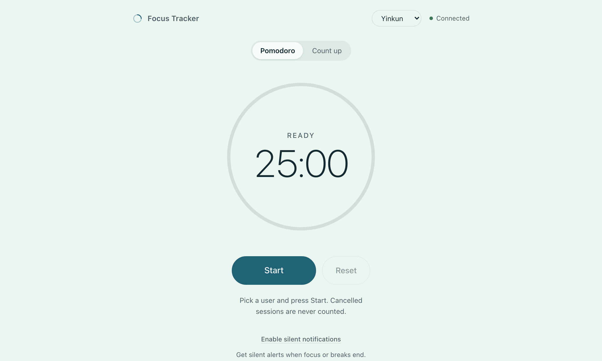
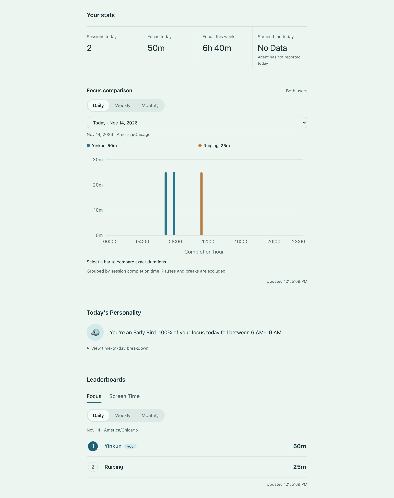
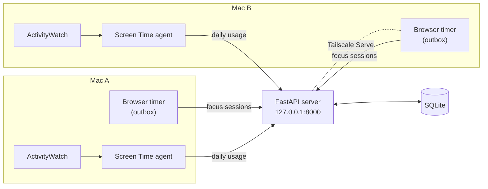

<div align="center">

# Focus Tracker

**A calm, self-hosted Pomodoro timer for two people, with shared focus leaderboards and ActivityWatch screen-time tracking.**

FastAPI · SQLite · vanilla JavaScript · no accounts · no build step · private over Tailscale

[](https://www.python.org/)
[](https://fastapi.tiangolo.com/)
[](https://www.sqlite.org/)
[](app/static/js)
[](https://activitywatch.net/)

[Quick start](#quick-start) · [Features](#features) · [How it works](#how-it-works) · [FAQ](#faq) · [Docs](#documentation)

<picture>
  <source media="(prefers-color-scheme: dark)" srcset="docs/images/timer-dark.png" />
  
</picture>

</div>

## What is Focus Tracker?

Focus Tracker is an open-source, self-hosted **Pomodoro and count-up focus timer** built for two people who keep each other accountable. Each person runs focus sessions in the browser. The app records completed sessions in SQLite and ranks both users on **daily, weekly and monthly Focus leaderboards**. An optional agent reads [ActivityWatch](https://activitywatch.net/) on each Mac to add a **Screen Time leaderboard** based on active foreground-window time.

It is for study partners, remote coworkers, couples or friends who want a shared focus timer without a SaaS account, a subscription or sending their data to a third party. The server runs on your own machine and is shared privately over [Tailscale](https://tailscale.com/).

**At a glance**

| | |
|---|---|
| Type | Self-hosted web app (Pomodoro timer + focus/screen-time leaderboard) |
| Users | Two trusted people, no login |
| Backend | Python 3.12+, FastAPI, SQLite |
| Frontend | Static HTML, CSS and ES modules, no framework and no build step |
| Screen time source | ActivityWatch (foreground window ∩ not-AFK), macOS |
| Remote access | Tailscale Serve (tailnet only) |
| Default timer | 25-minute focus / 5-minute break, plus count-up mode up to 2 hours |

## Features

<div align="center">
  
</div>

### Timer
- **Pomodoro timer:** persistent 25-minute focus / 5-minute break timer with pause/resume, reset and delayed-reopen recovery.
- **Count-up mode:** Stop & save records actual whole seconds as one session and automatically stops and saves at 2 hours. Modes cannot run simultaneously in the same browser origin.
- **Silent notifications:** opt-in browser notifications for focus/break completion. Use **Enable silent notifications** and allow the browser prompt. Unsupported browsers keep an in-page completion message. No audio is played.

### Stats and leaderboards
- **Focus leaderboards:** local-day history and day/week/month leaderboards, including DST boundaries and competition ranks.
- **Two-user focus chart:** shared bar chart below personal stats showing daily completion hours, weekly days and monthly Monday-aligned weeks. It opens the current period using the browser clock. The history menu lists only periods with recorded sessions. It uses fixed user colors and includes an accessible data table.
- **Personality:** a full-width "Today's Personality" card above the Leaderboards shows the selected user's focus rhythm for today (for example Early Bird or Night Owl) as a large icon with one short sentence and a simple time-of-day breakdown. Other users' results are not shown. See [Focus Rhythm](docs/focus-rhythm.md) for definitions and attribution.
- **Screen Time leaderboard:** ActivityWatch foreground-window time intersected with not-AFK time, with cumulative daily snapshots and historical backfill.
- **Honest coverage:** screen data that is incomplete, stale or missing is displayed but never ranked.

### Reliability
- **Offline-safe outbox:** completed sessions are queued, retried automatically, deduplicated by UUID and stored per record so tabs cannot overwrite each other.
- **Backups:** SQLite initialization, verified online backups and retention.
- **Tested:** automated checks cover Python services/API/agent and JavaScript timer/outbox/controller behavior. Real ActivityWatch accuracy, macOS login startup and two-machine Tailscale access require the manual checks in [testing](docs/testing.md).

## How it works



1. The browser runs the timer locally and queues each completed session in an outbox.
2. The outbox posts sessions to the FastAPI server, which validates, deduplicates and stores them in SQLite.
3. On each Mac, the agent reads ActivityWatch and uploads cumulative daily screen time for that device.
4. The page polls the API for stats, the comparison chart, today's focus personality and the leaderboards.

## Quick start

Requires Python 3.12+ and [uv](https://docs.astral.sh/uv/). Node.js 22+ is only needed for JavaScript tests.
Run commands from the repository root. **Before the first initialization**, edit display/device names in `database/seed.sql`. After initialization, rename existing rows with SQL `UPDATE`.

```bash
uv sync
uv run --no-sync python scripts/init_db.py
uv run --no-sync uvicorn app.main:app --host 127.0.0.1 --port 8000
```

- App: http://127.0.0.1:8000
- Interactive API docs: http://127.0.0.1:8000/docs
- Health: http://127.0.0.1:8000/api/health

Complete a timer session, then confirm the outbox clears and Focus totals update. Cancelled sessions and breaks are excluded. For a faster local check, start the server with `FOCUS_MIN_TARGET_SECONDS=1` and open `/?focus=10&break=5`; restore the normal minimum afterwards.

For open-ended work, select **Count up**, start, then **Stop & save** (also available while paused). Sessions shorter than one second are not saved. Focus totals and session counts update through the same offline outbox. Dates use the completion day in America/Chicago. Startup automatically migrates existing database rows to `mode="pomodoro"` without deleting history.

Notifications require HTTPS or localhost, browser permission and support for the silent option. They fire when the loaded page processes a completion; closed or suspended pages cannot guarantee an on-time alert. A notification-only service worker supports delivery where available, without adding offline caching or a background timer.

After updating frontend files, restart the server and refresh the page. HTML is not cached, and CSS plus the complete JavaScript module graph use a content-versioned URL prefix, preventing a new page from loading older cached modules.

## Screen Time agent

Install and run ActivityWatch on each Mac first; see [deployment](docs/deployment.md). Copy that Mac's device UUID from the initialization output:

```bash
uv sync --extra agent
export AGENT_DEVICE_ID=15ba172f-e397-4155-8285-6757a75875f1
export AGENT_SERVER_URL=http://127.0.0.1:8000
uv run --no-sync python -m agent.main --once
uv run --no-sync python -m agent.main
```

Use the second seeded UUID on the second Mac and the server's Tailscale HTTPS URL for remote access. One registered device per user. The agent normally re-queries the last seven days; `--once --backfill-days 30` repairs longer outages when ActivityWatch has that history. A failed one-shot sync exits nonzero. Days before tracking began are skipped, not uploaded as zero.

## Configuration and access

Server variables: `FOCUS_DB_PATH`, `FOCUS_BACKUP_DIR`, `FOCUS_BACKUP_KEEP` (14), `FOCUS_MIN_TARGET_SECONDS` (60), `FOCUS_MAX_TARGET_SECONDS` (14400), `CLOCK_SKEW_TOLERANCE_SECONDS` (300), `SCREEN_STALE_AFTER_SECONDS` (1200). All paths default under `data/`, which is ignored by Git. Agent variables and defaults are listed in `agent/config.py`.

The server binds to `127.0.0.1`; use Tailscale Serve for tailnet access. Never use Funnel. There is no authentication: either trusted user can select or submit data as the other. Timer state is local to a browser origin; clearing browser data loses unsynced sessions. An already loaded page works offline, but a fresh offline page load is not guaranteed. This app measures ActivityWatch non-AFK foreground time, not Apple's Screen Time or verified human attention.

## Checks

```bash
uv sync --extra agent
uv run --no-sync pytest -q
npm test
uv run --no-sync python scripts/backup_db.py --verify
```

`npm test` uses Node's built-in runner and requires no npm install. Tests use temporary databases and mocked ActivityWatch/network responses. See [testing](docs/testing.md) for coverage, reproducible smoke checks and integration limits.

## FAQ

**Is Focus Tracker free and self-hosted?**
Yes. You run the FastAPI server on your own computer. Data stays in a local SQLite file under `data/`, and nothing is sent to a third-party service.

**Can more than two people use it?**
It is designed for two trusted users. Each user is a row in `database/seed.sql` with one registered device. There are no accounts or passwords, so anyone who can reach the server can submit data as either user.

**Does it need ActivityWatch?**
No. The Pomodoro timer, count-up mode, focus chart, focus personality and Focus leaderboards work without it. ActivityWatch and the agent are only needed for the Screen Time leaderboard.

**Is the screen time the same as Apple Screen Time?**
No. It measures ActivityWatch foreground-window time while you are not AFK. Incomplete, stale or missing days are shown but never ranked.

**Does it work offline?**
An already loaded page keeps timing offline, and completed sessions wait in a browser outbox until the server is reachable again. A fresh page load while offline is not guaranteed.

**How do two people on different networks connect?**
Keep the server bound to `127.0.0.1` and publish it to your tailnet with Tailscale Serve. Do not use Tailscale Funnel, because the app has no authentication. See [deployment](docs/deployment.md).

**What do labels like "Early Bird" and "Night Owl" mean?**
They describe when most of today's focus time happened, in fixed time windows in America/Chicago. They are descriptive labels, not productivity scores. The rules are in [Focus Rhythm](docs/focus-rhythm.md).

**Do I need Node.js or a frontend build?**
No. The frontend is plain HTML, CSS and ES modules served by FastAPI. Node.js 22+ is only used to run the JavaScript tests.

## Documentation

| Path | Purpose |
|---|---|
| `app/routers/`, `app/schemas.py` | HTTP routes and API models |
| `app/services/`, `app/periods.py` | Persistence, validation, aggregation and calendar windows |
| `app/static/` | Browser timer, outbox, statistics and leaderboards |
| `app/static/js/focus-chart.js` | Shared two-user Focus chart, date/period controls and data table |
| `agent/` | Local ActivityWatch collection and HTTP sync |
| `database/`, `scripts/` | Schema, seed, initialization and backup |
| `tests/` | Python and JavaScript regression tests |
| [Design](docs/design.md) | Goals, invariants, coverage policy and limits |
| [API](docs/api.md) | Endpoint contracts and errors |
| [Database](docs/database.md) | Tables, connection settings and privacy |
| [Frontend](docs/frontend-backend.md) | Timer state, outbox, polling and offline behavior |
| [Focus Rhythm](docs/focus-rhythm.md) | Personality labels, thresholds and attribution |
| [Learning guide](docs/implementation-guide.md) | Suggested implementation order and reference explanations |
| [Deployment](docs/deployment.md) | ActivityWatch, Tailscale, launchd and restore |

## Learn by building it

This repository also works as a hands-on FastAPI + vanilla JavaScript exercise.

- `main` preserves the original TODO scaffold.
- `reference/complete-implementation` contains the working reference, bug fixes, tests and updated documentation.
- Start your own practice branch from `main`. Read [the learning guide](docs/implementation-guide.md) when comparing your implementation with this reference.

```bash
git diff main..reference/complete-implementation -- app/periods.py
git diff main..reference/complete-implementation -- app/services agent/collector.py
```

## Contributing

Issues and pull requests are welcome. Please run `uv run --no-sync pytest -q` and `npm test` before opening a PR, and read [Design](docs/design.md) for the invariants the app keeps.

<div align="center">

If Focus Tracker helps you and a friend focus, consider giving it a ⭐ so others can find it.

</div>
