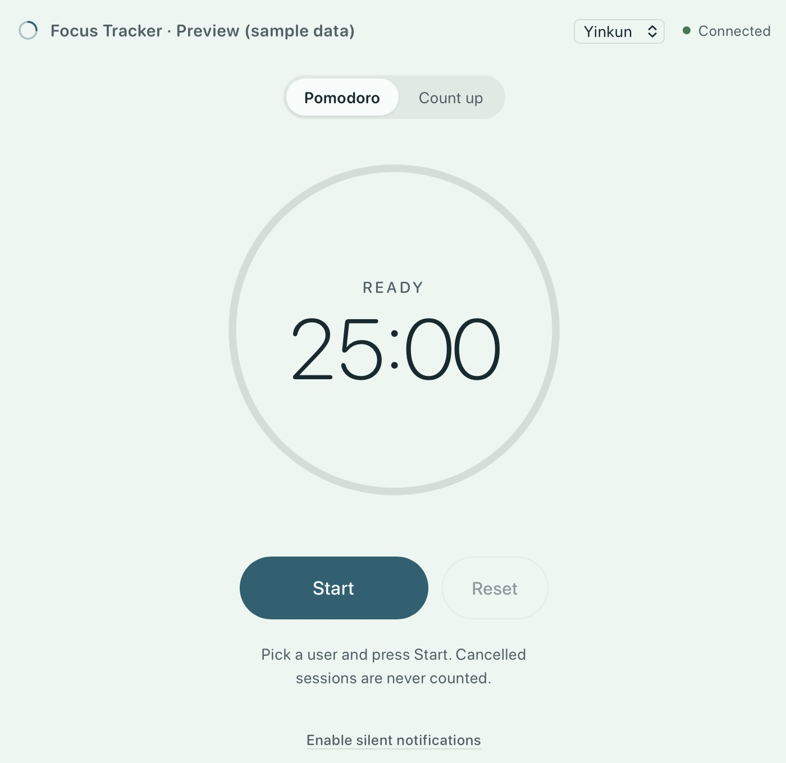
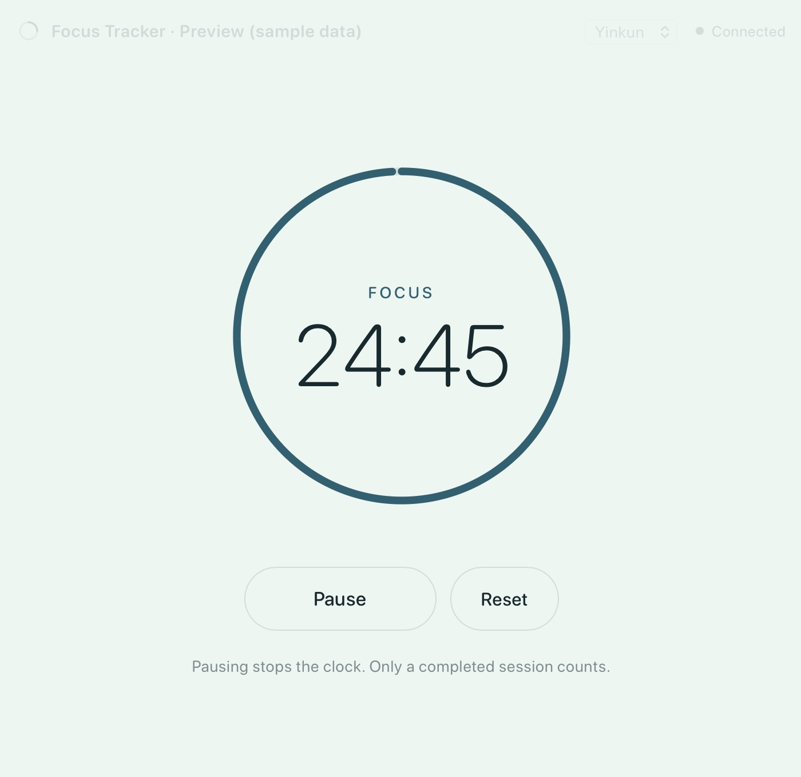
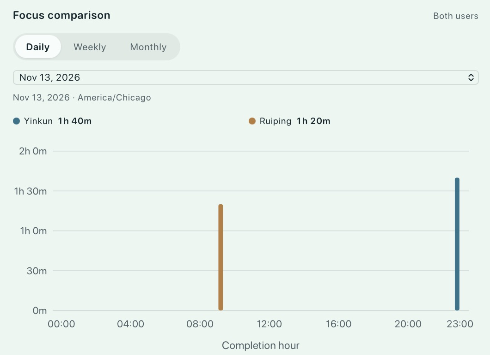
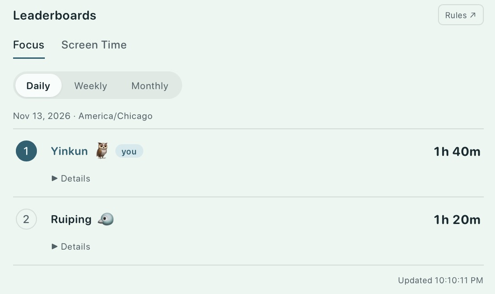
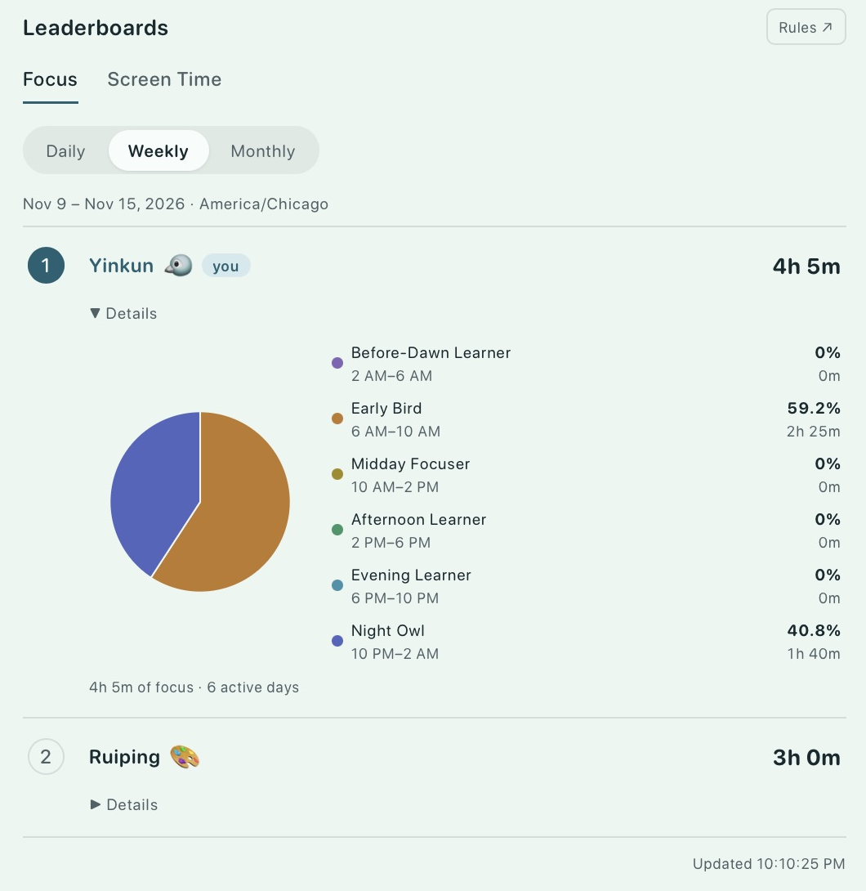
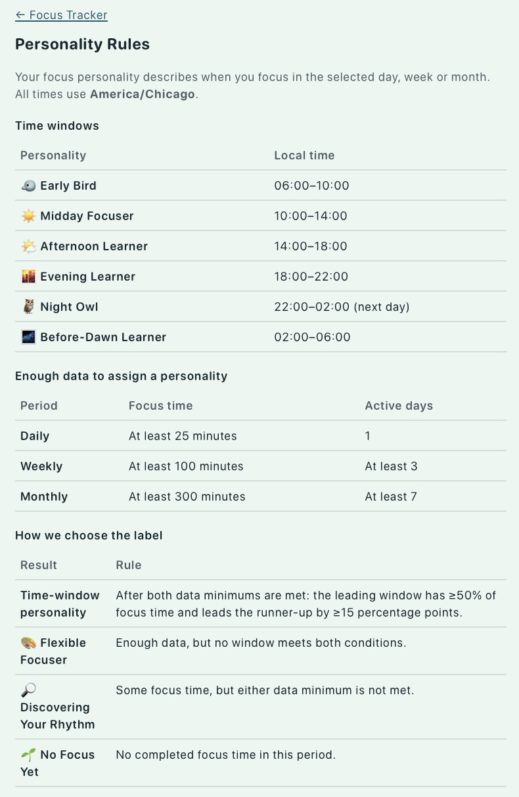

<div align="center">

# Focus Tracker

**和一个伙伴一起专注：自己部署的番茄钟、专注排行榜与屏幕时间统计。**

FastAPI · SQLite · 原生 JavaScript · 无需账号 · 无需前端构建 · 通过 Tailscale 私密访问

[English](README.md) · **简体中文**

[快速开始](#快速开始) · [主要功能](#主要功能) · [看图上手](#看图上手) · [常见问题](#常见问题) · [文档](#文档)



<sub>实际应用界面，使用示例数据。软件界面目前为英文。</sub>

</div>

## 这是什么？

Focus Tracker 是一个为两位伙伴设计的专注工具。你可以用番茄钟安排学习，也可以用正计时记录一段没有固定时长的工作。完成的专注会保存在自己的 SQLite 数据库中，并汇总成每日、每周、每月的双人排行榜。

它适合同学、朋友或一起工作的伙伴互相陪伴和督促。可选的 ActivityWatch 采集程序还能加入屏幕时间统计。应用运行在自己的电脑上，通过 Tailscale 与伙伴共享，无需注册 SaaS 账号或订阅。

| 项目 | 说明 |
|---|---|
| 使用人数 | 两位互相信任的用户，无登录系统 |
| 计时方式 | 默认专注 25 分钟 / 休息 5 分钟；另有最长 2 小时的正计时 |
| 专注统计 | 双人图表、日/周/月排行榜、对应周期的专注人格 |
| 屏幕时间来源 | ActivityWatch 的前台窗口时间与非 AFK 时间的交集 |
| 技术与存储 | Python 3.12+、FastAPI、SQLite、静态 HTML/CSS/JavaScript |
| 远程访问 | Tailscale Serve，仅向自己的 tailnet 开放 |

## 主要功能

### 专注计时

- **安静的专注界面：** 保留绿色主题和单列布局。点击 Start 后，统计、图表与排行榜淡出；暂停时仍保持纯计时视图。进入休息或回到待开始状态后，其他内容恢复。

- **番茄钟（Pomodoro）：** 默认 25 分钟专注、5 分钟休息，支持暂停、继续和重置；重新打开页面后恢复计时状态。
- **正计时（Count up）：** 适合时长不固定的任务。点击 **Stop & save** 保存实际秒数，暂停时也能保存；满 2 小时自动停止并保存。同一浏览器来源下，两种模式不能同时运行。
- **静默通知：** 点击 **Enable silent notifications** 并允许浏览器通知后，专注或休息结束时显示无声通知。不支持的浏览器保留页面内提示。

### 图表和排行榜

- **双人专注对比：** 日视图按完成小时分组，周视图按天分组，月视图按周一对齐的周分组。颜色固定，另有无障碍数据表。
- **历史记录：** 日期菜单列出当前周期与有记录的历史周期，支持日、周、月切换；图表与排行榜的选择同步。
- **专注人格：** 每个名字旁的小图标表示所选日、周或月的专注时段习惯。悬停或用键盘聚焦可查看英文名称；展开 **Details** 查看饼图、各时段占比与时长、活跃天数。
- **屏幕时间：** 安装 ActivityWatch 和采集程序后，可查看 **Screen Time** 排行榜，支持按用时升序或降序排列。数据不完整、过期或缺失时会显示状态，但不参与排名。

### 记录与可靠性

- **断网续传：** 已加载页面可以继续计时，完成记录先进入浏览器待发送队列，恢复连接后自动重试；UUID 去重，多个标签页分别存储待发送记录。
- **日历与备份：** 按 America/Chicago 时区处理日期和夏令时边界，支持 SQLite 在线备份、校验和保留策略。
- **自动检查：** Python 与 JavaScript 检查覆盖服务、API、采集程序及浏览器状态逻辑。真实 ActivityWatch 准确度、开机启动和两台机器的远程连接仍需按[测试文档](docs/testing.md)手动验证。

## 看图上手

以下截图来自真实前端，使用的是**示例数据**，不是真实个人记录。界面按钮保留英文，方便与软件对应。

### 开始专注，隐藏其他内容

点击 **Start** 后，页面淡出其他区域，突出计时器和本次计时控制。保留原版绿色主题、低透明度页眉、深色模式，以及减少动态效果的系统偏好。



### 1. 选择想看的日期

在 **Focus comparison（专注对比）** 中选择 **Daily（每日）**、**Weekly（每周）** 或 **Monthly（每月）**，再从日期菜单选择当前或有记录的历史周期。下面的排行榜和两个人的专注人格会一起切换。在排行榜点击周期按钮，也会同步更新图表。

**Your stats（个人统计）** 中的摘要继续显示今天和本周，不随历史日期切换。



### 2. 在名字旁看专注人格

示例中的 11 月 13 日，Yinkun 的专注集中在夜间，因此显示 **🦉 Night Owl（夜猫子）**；Ruiping 集中在早晨，因此显示 **🐦 Early Bird（早起鸟）**。这两个图标都对应所选日期。把鼠标放在图标上，或用键盘聚焦图标，就能读到英文名称。



### 3. 想看细节，再展开 Details

切换到 **Weekly** 并展开 **Details（详情）**。这个例子中，Yinkun 一周的专注有 **59.2%** 在早起鸟时段，**40.8%** 在夜猫子时段。周、月人格按整个周期的专注时长计算，不是把每天的标签拿来投票。



### 4. 用 Rules 查看计算规则

点击排行榜角落的 **Rules ↗（规则）**，会在新标签页打开只读说明。所有时段使用 **America/Chicago** 时区；周为周一至周日，月为自然月。

| 当地时间 | 界面英文名称 | 中文含义 |
|---|---|---|
| 02:00–06:00 | 🌌 Before-Dawn Learner | 黎明前的学习者 |
| 06:00–10:00 | 🐦 Early Bird | 早起鸟 |
| 10:00–14:00 | ☀️ Midday Focuser | 午间专注者 |
| 14:00–18:00 | 🌤️ Afternoon Learner | 午后学习者 |
| 18:00–22:00 | 🌆 Evening Learner | 晚间学习者 |
| 22:00–次日 02:00 | 🦉 Night Owl | 夜猫子 |

达到最低数据量后，领先时段须占专注时长的 **至少 50%**，并领先第二名 **至少 15 个百分点**，才会得到对应标签。

| 周期 | 最低专注时长 | 最低活跃天数 |
|---|---|---|
| 每日 | 25 分钟 | 1 天 |
| 每周 | 100 分钟 | 3 天 |
| 每月 | 300 分钟 | 7 天 |

数据足够但没有明显主导时段时，显示 **🎨 Flexible Focuser（灵活专注者）**；数据不足时显示 **🔎 Discovering Your Rhythm（正在发现你的节奏）**；没有专注记录时显示 **🌱 No Focus Yet（暂无专注记录）**。标签描述专注发生的时间，不用于评价效率高低。

<details>
<summary>查看 Personality Rules 规则页截图</summary>



</details>

人格计算会把已完成的专注记录按实际时段和午夜拆分；新记录排除暂停和休息，旧记录使用估算时段并在 Details 中说明。图表和排名按完成日期归属，因此跨日、跨周或跨月时，总时长可能与人格明细不同。完整说明见 [Focus Rhythm](docs/focus-rhythm.md)。

## 工作方式

1. 浏览器在本地计时，将完成的专注放进待发送队列。
2. 队列把记录提交给 FastAPI，服务器校验、去重并存入 SQLite。
3. 如需屏幕时间，每台 Mac 的采集程序读取 ActivityWatch，并上传该设备每天累计的有效时长。
4. 页面定期读取统计、对比图、所选周期的人格与排行榜；另一位伙伴可通过 Tailscale 访问同一服务器。

## 快速开始

需要 **Python 3.12+** 和 [uv](https://docs.astral.sh/uv/)。只有运行 JavaScript 测试才需要 Node.js 22+，前端无需安装依赖或构建。

在仓库根目录执行命令。**首次初始化之前**，先在 `database/seed.sql` 修改显示名称和设备名称；初始化后如需重命名已有记录，请使用 SQL `UPDATE`。

```bash
git clone --branch reference/complete-implementation https://github.com/KaneYin/promodoro_timer.git
cd promodoro_timer
uv sync
uv run --no-sync python scripts/init_db.py
uv run --no-sync uvicorn app.main:app --host 127.0.0.1 --port 8000
```

- 应用：http://127.0.0.1:8000
- 交互式 API 文档：http://127.0.0.1:8000/docs
- 健康检查：http://127.0.0.1:8000/api/health

选择用户并完成一次专注，确认待发送队列清空、Focus 总时长更新。取消的专注和休息不会计入。若要快速本地检查，以 `FOCUS_MIN_TARGET_SECONDS=1` 启动服务器，再打开 `/?focus=10&break=5`；检查后恢复正常最低时长。

正计时可在运行或暂停时点击 **Stop & save**，不足 1 秒不保存；同样通过待发送队列更新总时长和次数。完成日期使用 America/Chicago。启动时会自动把旧记录的模式补为 `pomodoro`，不会删除历史记录。

通知需要 HTTPS 或 localhost、浏览器授权及 silent 选项支持。页面处理完成事件时才触发通知；页面关闭或被挂起时不能保证准时提醒。通知用途的 service worker 不提供离线页面缓存或后台计时器。

前端更新后重启服务器并刷新页面。HTML 不缓存，CSS 和完整 JavaScript 模块使用基于内容版本的 URL，防止新页面加载旧模块。

## 配置屏幕时间采集程序

先在每台 Mac 安装并运行 ActivityWatch，详见[部署文档](docs/deployment.md)。从初始化输出复制这台 Mac 对应的设备 UUID：

```bash
uv sync --extra agent
export AGENT_DEVICE_ID=15ba172f-e397-4155-8285-6757a75875f1
export AGENT_SERVER_URL=http://127.0.0.1:8000
uv run --no-sync python -m agent.main --once
uv run --no-sync python -m agent.main
```

第二台 Mac 使用另一个预置 UUID；远程采集时，服务器地址改为服务器的 Tailscale HTTPS URL。每个用户对应一台登记设备。采集程序通常重查最近七天；较长中断可用 `--once --backfill-days 30` 补传，但需要 ActivityWatch 保留相应历史。单次同步失败会以非零状态退出。跟踪开始前的日期会跳过，不会当作零时长上传。

## 配置与访问范围

服务器变量：`FOCUS_DB_PATH`、`FOCUS_BACKUP_DIR`、`FOCUS_BACKUP_KEEP`（14）、`FOCUS_MIN_TARGET_SECONDS`（60）、`FOCUS_MAX_TARGET_SECONDS`（14400）、`CLOCK_SKEW_TOLERANCE_SECONDS`（300）、`SCREEN_STALE_AFTER_SECONDS`（1200）。路径默认在 Git 忽略的 `data/` 目录下。采集程序配置见 `agent/config.py`。

服务器绑定 `127.0.0.1`，通过 **Tailscale Serve** 向自己的 tailnet 开放，**不要使用 Funnel**。应用没有身份验证，能访问服务器的人可以选择或代任一用户提交记录，因此只适合互相信任的人。

计时状态属于当前浏览器来源；清除浏览器数据会丢失尚未同步的记录。已加载页面可以离线计时，但不能保证断网时首次打开页面成功。屏幕时间表示 ActivityWatch 非 AFK 的前台使用时长，不等同于 Apple Screen Time，也不证明人在持续专注。

## 开发检查

```bash
uv sync --extra agent
uv run --no-sync pytest -q
npm test
uv run --no-sync python scripts/backup_db.py --verify
```

`npm test` 使用 Node 内置测试运行器，无需 `npm install`。测试使用临时数据库和模拟的 ActivityWatch/网络响应。覆盖范围、可重复的冒烟检查和集成限制见[测试文档](docs/testing.md)。

## 常见问题

**不用 ActivityWatch 也能用吗？** 可以。计时、专注图表、专注人格和 Focus 排行榜都可以独立使用，只有 Screen Time 需要 ActivityWatch 和采集程序。

**可以超过两个人吗？** 当前按两位可信用户设计，每人对应 `database/seed.sql` 中的用户与一台设备，没有账号或密码系统。

**数据保存在哪里？** 自己电脑的 SQLite 数据库，默认位于 `data/`。应用的记录由自己的服务器处理。

**断网怎么办？** 已加载页面可以继续计时，完成记录等待连接恢复后再同步；断网时首次加载页面不保证可用。

**两个人不在同一网络怎么办？** 使用 Tailscale Serve 访问同一个服务器，具体步骤见[部署文档](docs/deployment.md)。

**Night Owl 和 Early Bird 是只看今天吗？** 它们对应当前选中的日、周或月；历史日期也会计算当期结果。它们表示时段习惯，不是效率评分。

**软件有中文界面吗？** 目前界面为英文，本 README 提供中文说明，并保留按钮的英文原文方便对照。

## 文档

以下技术文档目前主要为英文。

| 路径 / 文档 | 内容 |
|---|---|
| `app/routers/`、`app/schemas.py` | HTTP 路由与 API 模型 |
| `app/services/`、`app/periods.py` | 存储、校验、统计与日历周期 |
| `app/static/` | 计时器、待发送队列、图表和排行榜 |
| `agent/` | ActivityWatch 采集与同步 |
| `database/`、`scripts/` | 表结构、种子数据、初始化与备份 |
| `tests/` | Python 与 JavaScript 回归检查 |
| [Product](PRODUCT.md) / [Design rationale](docs/design-rationale.md) | 单列布局、纯计时视图与视觉设计依据 |
| [Design](docs/design.md) | 设计目标、数据覆盖策略与限制 |
| [API](docs/api.md) | 接口与错误约定 |
| [Database](docs/database.md) | 数据表、连接配置与隐私 |
| [Frontend](docs/frontend-backend.md) | 前端状态、定期更新与离线行为 |
| [Focus Rhythm](docs/focus-rhythm.md) | 人格定义、门槛与时长归属 |
| [Learning guide](docs/implementation-guide.md) | 练习顺序与实现说明 |
| [Deployment](docs/deployment.md) | ActivityWatch、Tailscale、launchd 与恢复 |

## 通过实现来学习

`main` 保留原始 TODO 脚手架；**`reference/complete-implementation` 是可运行的参考分支**，包含修复、测试与文档。想自己练习，可从 `main` 新建练习分支，再结合[学习指南](docs/implementation-guide.md)对照实现。

```bash
git diff main..reference/complete-implementation -- app/periods.py
git diff main..reference/complete-implementation -- app/services agent/collector.py
```

## 参与改进

每次更新用户可见功能，必须在同一次修改中同步维护 [English](README.md) 和[简体中文](README.zh-CN.md) README，写清功能与操作方法；界面改变时更新对应的真实截图，并标明示例数据。项目约定记录在 [AGENTS.md](AGENTS.md)。

欢迎提交 Issue 和 PR。PR 以 `reference/complete-implementation` 为目标，按改动范围运行相应检查，并阅读 [Design](docs/design.md) 中的数据约定。
