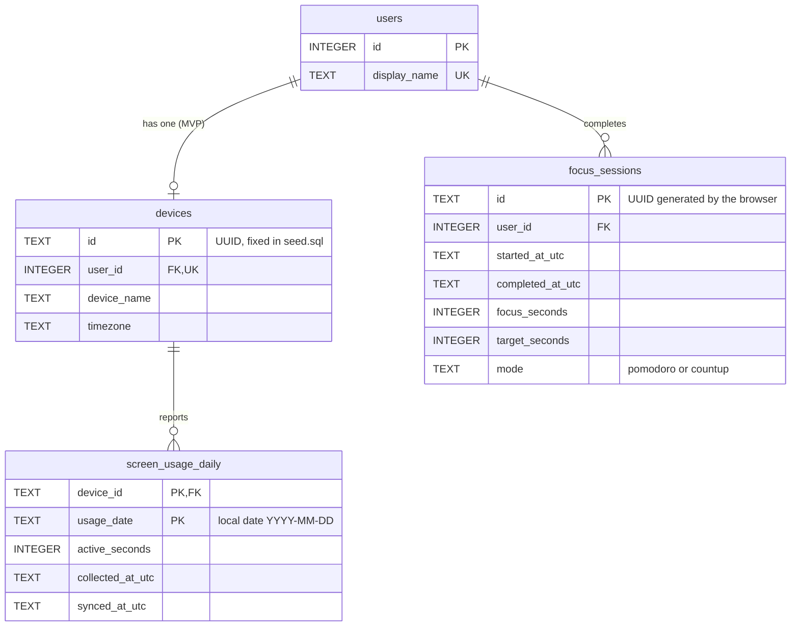

# Database Design

SQLite, accessed with the standard `sqlite3` module. Schema: `database/schema.sql`. Preset rows: `database/seed.sql`.
Both are idempotent. The server runs them on every start, and `scripts/init_db.py` runs them on demand.
Startup also migrates older databases by adding `focus_sessions.mode` with default `pomodoro`; existing rows are preserved. Back up an existing DB before upgrading.

Startup also creates `focus_session_segments (session_id, position, started_at_utc, ended_at_utc)`, keyed by `(session_id, position)` with a cascading foreign key to `focus_sessions.id`. UTC segment timestamps preserve fractional seconds in ISO format; use `datetime.fromisoformat` for these fields. Missing segment rows identify legacy records. Segments and sessions are inserted in one transaction. See [Focus Rhythm](focus-rhythm.md) for validation and estimation rules.

## ER diagram

## Tables

### users
| Column | Notes |
|---|---|
| `id` | Integer PK. The API and frontend use it as `user_id`. |
| `display_name` | Unique. Shown in the UI. |

Two rows are seeded. There are no credentials. Rename a user with
`UPDATE users SET display_name = 'Kane' WHERE id = 1;`.

### devices
| Column | Notes |
|---|---|
| `id` | UUID string. The agent sends it as `device_id`. |
| `user_id` | `UNIQUE`: one device per user in the MVP. Drop the constraint to allow several. |
| `timezone` | Informational for now. Day boundaries come from the leaderboard timezone. |

### focus_sessions
One row per completed Pomodoro or stopped/capped count-up session. Discarded sessions never reach the server.

| Column | Notes |
|---|---|
| `id` | UUID made by the browser. This is the idempotency key. |
| `started_at_utc` | When the user first pressed Start. |
| `completed_at_utc` | When the Pomodoro completed, count-up was stopped, or its 2-hour cap was reached. Decides the local day/week/month. |
| `focus_seconds` | Time actually spent focusing, pauses excluded. |
| `target_seconds` | Planned Pomodoro length (1500 by default), or 7200 for count-up. |
| `mode` | `pomodoro` by default, or `countup`. Count-up duration may be less than its target. |

Index `idx_focus_sessions_user_completed (user_id, completed_at_utc)` supports both the history query and the leaderboard sum.

### screen_usage_daily
One row per (device, local day). The value is a **cumulative snapshot** and is overwritten, never added to.

| Column | Notes |
|---|---|
| `usage_date` | Local calendar date in `America/Chicago`, `YYYY-MM-DD`. |
| `active_seconds` | Non-AFK foreground-window seconds for that day. `0` means "measured, none". No row means "unknown". |
| `collected_at_utc` | When the agent computed the value. Decides which of two uploads is newer. |
| `synced_at_utc` | When the server stored it. Together with collection time, determines today's freshness. Historical reuploads do not refresh today. |

## Conventions

**Session and sync instants** are stored as UTC text in a fixed format, `YYYY-MM-DDTHH:MM:SSZ` (whole seconds).
Fixed width means string comparison equals time comparison, so `completed_at_utc >= ? AND completed_at_utc < ?` is correct.
Helpers: `app/timeutil.py`.

**Active-segment instants** are UTC ISO strings with fractional seconds preserved.
Parse them with `datetime.fromisoformat`; the whole-second helper does not parse this separate format.

**Calendar dates** (`usage_date`) are plain `YYYY-MM-DD` text in the leaderboard timezone.

**Period windows** are half-open `[start, end)`.
- For `focus_sessions`, convert local midnights to UTC instants (`app/periods.py`) and compare against `completed_at_utc`.
- For `screen_usage_daily`, compare dates directly: `usage_date >= start_date AND usage_date < end_date_exclusive`.

**Missing is not zero.** The leaderboard must distinguish "no row" (`no_data`) from `active_seconds = 0`.

## Connection settings

Applied by `app/database.py` on every connection:

| Setting | Why |
|---|---|
| `PRAGMA foreign_keys = ON` | Off by default and per connection. Without it, FKs are not enforced. |
| `PRAGMA journal_mode = WAL` | Readers do not block the writer. |
| `PRAGMA synchronous = NORMAL` | Standard pairing with WAL. |
| `PRAGMA busy_timeout = 5000` | A blocked writer waits up to 5 s instead of failing at once. |

One connection per HTTP request (`Depends(get_db)`), closed when the request ends.

## Query shapes you will need

These are descriptions, not finished SQL. See `docs/implementation-guide.md` for the pitfalls.

- Focus total per user in a window: every user must appear, including those with no sessions.
- Screen total per user in a window: join `users` -> `devices` -> `screen_usage_daily`. Users with no rows must appear as `no_data`.
- Current-window freshness: inspect today's row's collection and receipt times, not a maximum across historical dates.
- Historical-window last sync: `MAX(synced_at_utc)` over the window's rows.
- Coverage: count actual right-side daily records, never `COUNT(*)` after an outer join; compare with elapsed calendar dates. See [design.md](design.md).

## Backup and restore

`scripts/backup_db.py` uses `sqlite3.Connection.backup()` and is safe while the server runs. See `docs/deployment.md`.

## Privacy

Only daily totals are stored. Window titles, URLs and raw ActivityWatch events never leave the Mac.
