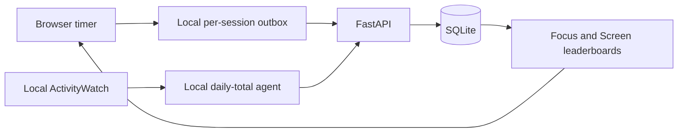

# Product and implementation design

## Scope

Two trusted people compare focused duration and computer usage. Each person has one registered Mac. One always-on Mac hosts FastAPI and SQLite; both Macs reach it through Tailscale Serve. Each Mac runs its own ActivityWatch and sync agent. There is no registration, authentication or public hosting.

## Data flow

## Time and persistence invariants

- All calendar dates use `America/Chicago`, including both agents, regardless of the machine's system timezone.
- Stored instants are aware UTC, normalized to fixed-width whole-second strings.
- Day/week/month windows are half-open. Weeks begin Monday. Local midnight conversion handles DST independently at both boundaries.
- Focus is assigned to its completion date. Pauses and breaks are excluded; cancelled sessions are never saved.
- A Focus UUID identifies immutable content. Equal retries succeed, changed content conflicts, and competing writes are serialized.
- Screen Time is a cumulative snapshot per device/date. Newer collections replace; older/equal collections do not refresh server receipt time.

## Screen coverage and status

`days_expected` is the number of calendar dates from period start through the earlier of period end and today, including today. Future dates are excluded. `days_with_data` counts actual daily records, including genuine zero records. One registered device per user makes this a date count.

Apply these rules in order:

| Condition | Status | Ranked? |
|---|---|---|
| No rows in elapsed portion of window | `no_data`, duration `null` | No |
| Window contains today, and today's row is missing or either its collection or receipt time is older than the freshness threshold | `stale`, retain known total | No |
| Rows exist but fewer dates are present than `days_expected` | `partial`, retain known total | No |
| All elapsed dates are present, with fresh today data if applicable | `available` | Yes |

Historical windows never become stale, but can remain partial. Future-only windows have no data and zero expected days. A current window's `last_synced_at_utc` refers specifically to today's row, or is null if absent. A historical window uses the latest receipt in that window. This prevents a backfill of yesterday from disguising a failed collection today.

Available entries are sorted by duration (Focus descending, Screen ascending by default), then user id. Equal totals share competition ranks (1, 1, 3). Unranked groups follow in the order partial, stale, no_data, each sorted by user id.

Coverage means recorded dates, not continuous observation. The system cannot prove that ActivityWatch ran all day, reconstruct days before installation, or distinguish every watcher outage from true inactivity. First-day totals start when tracking began. The UI exposes coverage and does not claim audited activity measurement.

## Browser resilience

The shared Focus chart lives below personal stats and always requests both users, independently of the selected user. User-id-based colors remain fixed. Day/week/month views group sessions by completion hour/day/week respectively, using the same timezone and whole-session attribution as Focus rankings. Monthly weeks start Monday and are clipped to month bounds; daily DST bins represent real hours, so repeated local hours stay distinct. Date navigation is local to the chart. Bar selection exposes both durations, with a data table as an accessible alternative.

Each chart period total equals the corresponding user's Focus leaderboard total. The stored data has no active-segment timeline; completion-hour grouping deliberately avoids treating paused wall-clock intervals as focused activity. Empty bins are zero; failed requests and offline state show an unavailable message rather than stale totals. Request sequencing prevents an older date/period reply from replacing a newer selection.

The timer uses persisted wall-clock timestamps, so throttling and reloads do not lose elapsed time. Sleep counts as focus; a late reopen records the original deadline and skips an already elapsed break. Starting another Focus requires a deliberate Start.

Pomodoro counts only completed targets, then starts a break. Count-up records actual whole seconds on Stop & save or at its fixed two-hour cap, then returns to Ready without a break. Pause excludes elapsed idle time. A subsecond count-up cannot be saved. Modes share one persisted timer and cannot run simultaneously in the same browser origin.

Before completing Focus, the browser synchronously persists its payload under a per-UUID localStorage key, then saves Break/Ready state. Manual count-up stop first persists a recoverable COMPLETED boundary, freezing its duration and completion timestamp so a failed outbox write cannot create changed retry content. A crash can replay the same UUID safely. Upload success removes only that key. Permanent failures are retained in a separate per-UUID rejected record; transient failures retry. Web Locks coordinate timer mutations between tabs in supporting browsers. Without them, storage events provide best-effort timer synchronization; per-record outbox storage remains independent of whole-array update races.

An already loaded page continues offline. It hides server totals and ranks until reconnecting. User-list failures retry after recovery. The optional notification worker has no fetch interception or offline caching, so fresh offline page loading is not guaranteed. Clearing browser data loses unsynced records. Local timer state and queues are scoped to origin, so localhost and the Tailscale HTTPS URL have separate state.

Notifications are enabled only by an explicit button and browser permission. Every delivery passes `silent: true` and no vibration option; there is no audio playback. Browsers without silent-notification support use the in-page completion notice instead. Service-worker delivery supports browsers where page constructors are unavailable, with a desktop constructor fallback. Notifications do not schedule closed-page timers; a suspended page processes completion on resumption. See [MDN silent notifications](https://developer.mozilla.org/en-US/docs/Web/API/Notification/silent) and [mobile delivery](https://developer.mozilla.org/en-US/docs/Web/API/Notification/Notification).

## Access, privacy and operation

Only daily totals leave ActivityWatch's Mac. Titles, URLs and raw event streams are not uploaded to the Focus server. The ActivityWatch API remains local. Either trusted person can impersonate the other through the API; this is an accepted MVP limit, not an identity system.

SQLite uses WAL and per-request connections. Online backups use SQLite's backup API, unique filenames and atomic publication of completed files. Login startup uses launchd LaunchAgents, which begin after user login; it does not promise a pre-login service. The hosting Mac must stay awake and reachable.

Acceptance criteria and limits of automated verification are in [testing.md](testing.md).
