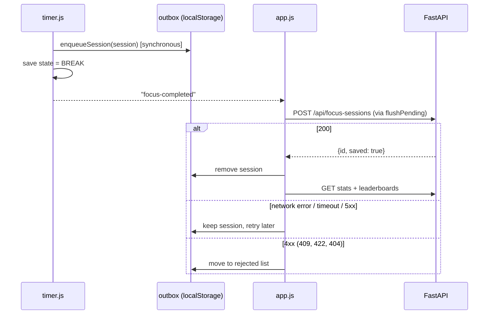

# Frontend ↔ Backend Interaction

The frontend is static ES modules in `app/static/` with no build step. FastAPI serves it at `/`, and the JSON API lives under `/api` on the same origin, so there is no CORS setup.

## Files

| File | Responsibility |
|---|---|
| `index.html`, `css/style.css` | Single page: header, timer, stats, leaderboards |
| `js/timer.js` | Timer state machine. No DOM, no network. |
| `js/api.js` | `fetch` wrappers, `ApiError`, and the offline outbox for completed sessions |
| `js/leaderboard.js` | Leaderboard panel (tabs, period, order, rendering) |
| `js/app.js` | Wires everything together, user selector, stats, polling |
| `js/util.js` | Formatting, UUID, timezone-safe "today" |

Dev shortcut: `/?focus=10&break=5` makes the phases 10 s and 5 s. The server still applies its own minimum target (`FOCUS_MIN_TARGET_SECONDS`, default 60), so lower that env var to test saving with short sessions.

## Timer

State machine:

```
IDLE --start--> FOCUSING <--pause/resume--> PAUSED
                  |
                  | target reached
                  v
              COMPLETED (transient: session handed to the outbox)
                  |
                  v
                BREAK --time up or "Skip break"--> IDLE

reset: FOCUSING / PAUSED / BREAK --> IDLE   (no session is produced)
```

Time is derived from `Date.now()` and persisted fields, never from counting `setInterval` ticks:

```
elapsed   = accumulatedMs + (segmentStartMs ? now - segmentStartMs : 0)
remaining = targetMs - elapsed
```

- **Pause** banks the running segment into `accumulatedMs` and clears `segmentStartMs`.
- **Resume** sets `segmentStartMs = now`.
- `setInterval(250 ms)` only redraws. Background tabs may throttle it, and `visibilitychange` recomputes on return.
- **Completion time** is `segmentStart + remaining-at-segment-start`, not "now". If the page was closed past the end, the session is still recorded with the true end time. The break is then measured from that moment, so a very late reopen lands in IDLE.
- `focus_seconds` equals the target, because only fully completed sessions are saved.
- The session keeps the `user_id` of whoever pressed Start. The user selector is locked during FOCUSING/PAUSED.

### localStorage keys

| Key | Content |
|---|---|
| `focusTracker.userId` | Selected user |
| `focusTracker.timer.v1` | Timer state (phase, session id, started-at, accumulated ms, segment start) |
| `focusTracker.pending.v2.<uuid>` | One completed session not yet accepted by the server |
| `focusTracker.rejected.v2.<uuid>` | One permanently refused session, including the reason |

A `storage` event listener follows changes from other tabs. Web Locks serialize timer controls and completion where supported. If both tabs replay completion, the server deduplicates by UUID. The old `pendingSessions.v1` and `rejectedSessions.v1` arrays migrate on first read; records are written before the old arrays are deleted. Per-record keys prevent an upload removing one session from overwriting another tab's new enqueue.

## Completing a session (outbox flow)



Order matters: the outbox write happens **before** the timer state advances. A crash between the two replays the same session id, and `enqueueSession` and the server both de-duplicate by id.

Retry triggers: right after completion, every 60 s, on the browser `online` event, on tab becoming visible, and on page load. Concurrent flushes share one in-flight run.

## Data the page loads

| UI element | Request |
|---|---|
| User dropdown | `GET /api/users` |
| Connection pill | `GET /api/health` every 30 s |
| Sessions today, Focus today | `GET /api/focus-sessions?user_id=&start_date=today&end_date=today` |
| Focus this week | `GET /api/leaderboards?metric=focus&period=week` (the user's entry) |
| Screen time today and last sync | `GET /api/leaderboards?metric=screen&period=day` (the user's entry) |
| Leaderboard panel | `GET /api/leaderboards?metric=…&period=…&order=…` |

Statistics and leaderboards refresh every 60 s, on tab visibility recovery, and after a session sync. Health is also checked every 30 s. A failed initial user request is retried after a successful health check until the list loads.

"Today" is computed in `America/Chicago` with `Intl.DateTimeFormat` (`todayInTimezone`), not in the browser's local zone. The server defines day boundaries in that zone, so a user in another timezone sees the same buckets. The constant `LEADERBOARD_TZ` in `util.js` must match `LEADERBOARD_TZ_NAME` in `app/config.py`.

Stats count only what the server has. Unsynced sessions appear in the banner, not in the totals.

## Rendering rules (honest data)

| API says | UI shows |
|---|---|
| `data_status: "no_data"` | "No Data" badge, rank `–`, never `0m` |
| `data_status: "stale"` | Duration with a "Stale" badge, rank `–` |
| `data_status: "partial"` | Known duration with a "Partial" badge and date coverage, rank `–` |
| Any non-available screen entry | Notice that missing data is not zero |
| `rank: null` | `–` |
| `order` | Order toggle only on the Screen tab. Switching metric resets to that metric's default order. |

All server strings are inserted with `textContent` (`el()` helper), never `innerHTML`.

## Error handling

| Situation | Behaviour |
|---|---|
| Server unreachable | Pill says Offline. Timer keeps running. Completed sessions wait in the outbox. Leaderboard shows a message instead of old numbers. |
| 4xx on session upload | Session moved to the rejected list, banner shows the count, details in the browser console. |
| Stale responses | Each leaderboard request has a sequence number. Out-of-order replies are dropped. |
| User request fails on an already loaded page | Falls back to the remembered user, then retries after recovery. |

## Known limits (accepted for the MVP)

- Clearing browser data loses unsynced sessions.
- There is no service worker; opening or reloading a page while offline is not guaranteed. Already loaded pages keep timing offline.
- Browser state is origin-specific: localhost and Tailscale HTTPS have separate timer/outbox storage.
- Browsers without Web Locks have best-effort cross-tab timer synchronization.
- No real-time timer sync across different browsers or devices.
- Sleep time counts as focus time (wall clock). Use Reset if that is wrong.
- Anyone who can open the page can choose either user.
