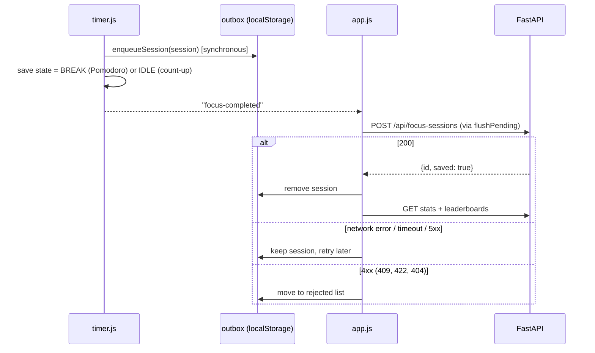

# Frontend ↔ Backend Interaction

The frontend is static ES modules in `app/static/` with no build step. FastAPI serves it at `/`, and the JSON API lives under `/api` on the same origin, so there is no CORS setup.

## Files

| File | Responsibility |
|---|---|
| `index.html`, `css/style.css` | Single page: header, timer, stats, leaderboards |
| `js/timer.js` | Timer state machine. No DOM, no network. |
| `js/screen-lock.js` | Screen lock detection via Idle Detection API (`screenState`); auto-pauses when locked, auto-resumes when unlocked |
| `js/notifications.js`, `notification-worker.js` | Opt-in silent completion notifications and notification clicks; no offline caching |
| `js/api.js` | `fetch` wrappers, `ApiError`, and the offline outbox for completed sessions |
| `js/leaderboard.js` | Leaderboard panel (tabs, period, order, rendering) |
| `js/focus-chart.js` | Shared grouped bar chart, fixed user colors, recorded-period menu and accessible data table |
| `js/app.js` | Wires everything together, user selector, stats, polling |
| `js/util.js` | Formatting, UUID, timezone-safe "today" |

Dev shortcut: `/?focus=10&break=5` makes the phases 10 s and 5 s. The server still applies its own minimum target (`FOCUS_MIN_TARGET_SECONDS`, default 60), so lower that env var to test saving with short sessions.

## Timer

State machine:

```
IDLE --start--> FOCUSING <--pause/resume--> PAUSED
                  |
                  | target reached
                  v
              session handed to the outbox
                  |
                  v
                BREAK --time up or "Skip break"--> IDLE

reset: FOCUSING / PAUSED / BREAK --> IDLE   (no session is produced)

Count-up: IDLE -> FOCUSING <-> PAUSED -> COMPLETED (durable stop boundary) -> IDLE
         Two-hour cap also completes and saves automatically; there is no break.
```

Time is derived from `Date.now()` and persisted fields, never from counting `setInterval` ticks:

```
elapsed   = accumulatedMs + (segmentStartMs ? now - segmentStartMs : 0)
remaining = targetMs - elapsed
```

- **Pause** banks the running segment into `accumulatedMs` and clears `segmentStartMs`.
- **Resume** sets `segmentStartMs = now`.
- **Screen lock auto-pause / resume**: The browser reads physical screen lock status via the Idle Detection API (`screenState` in `IdleDetector`). When the OS locks the screen (`screenState === "locked"`), active focus sessions in both Pomodoro and Count-up modes are automatically paused so locked screen time is not accumulated. When unlocked (`screenState === "unlocked"`), the session resumes automatically. In Count-up mode, Stop & save continues to be available while paused by lock, and saving accurately excludes all locked screen duration. Manual user pauses are preserved and will not be auto-resumed on screen unlock.
- `setInterval(250 ms)` only redraws. Background tabs may throttle it, and `visibilitychange` recomputes on return.
- **Completion time** is `segmentStart + remaining-at-segment-start`, not "now". If the page was closed past the end, the session is still recorded with the true end time. The break is then measured from that moment, so a very late reopen lands in IDLE.
- Pomodoro's `focus_seconds` equals the target. Count-up uses actual elapsed whole seconds (1..7200), with target 7200. Both use the completion date in America/Chicago.
- Manual count-up stops persist a COMPLETED boundary before the outbox write so retries retain exactly the same duration and completion time.
- The session keeps the `user_id` of whoever pressed Start. The user selector is locked during FOCUSING/PAUSED.

### localStorage keys

| Key | Content |
|---|---|
| `focusTracker.userId` | Selected user |
| `focusTracker.timer.v1` | Timer state (phase, session id, started-at, accumulated ms, segment start) |
| `focusTracker.pending.v2.<uuid>` | One completed session not yet accepted by the server |
| `focusTracker.rejected.v2.<uuid>` | One permanently refused session, including the reason |
| `focusTracker.notifications.v1` | Explicit opt-in for silent notifications |
| `focusTracker.deliveredNotifications.v1` | Recent notification tags for best-effort replay deduplication |

A `storage` event listener follows changes from other tabs. Web Locks serialize timer controls and completion where supported. If both tabs replay completion, the server deduplicates by UUID. The old `pendingSessions.v1` and `rejectedSessions.v1` arrays migrate on first read; records are written before the old arrays are deleted. Per-record keys prevent an upload removing one session from overwriting another tab's new enqueue.

## Completing a session (outbox flow)



Order matters: the outbox write happens **before** advancing to Break/Ready. Count-up manual stop first freezes its timestamp in recoverable COMPLETED state. A crash replays the same payload and session id, and `enqueueSession` and the server both de-duplicate by id.

Retry triggers: right after completion, every 60 s, on the browser `online` event, on tab becoming visible, and on page load. Concurrent flushes share one in-flight run.

## Data the page loads

| UI element | Request |
|---|---|
| User dropdown | `GET /api/users` |
| Connection pill | `GET /api/health` every 30 s |
| Sessions today, Focus today | `GET /api/focus-sessions?user_id=&start_date=today&end_date=today` |
| Focus this week | `GET /api/leaderboards?metric=focus&period=week` (the user's entry) |
| Screen time today and last sync | `GET /api/leaderboards?metric=screen&period=day` (the user's entry) |
| Leaderboard panel | `GET /api/leaderboards?metric=…&period=…&order=…` |
| Shared Focus chart | `GET /api/focus-stats?period=…&date=…` (always both users; no user filter) |
| Chart history options | `GET /api/focus-stats/dates` (SQL completion dates across both users) |

Statistics and leaderboards refresh every 60 s, on tab visibility recovery, and after a session sync. Health is also checked every 30 s. A failed initial user request is retried after a successful health check until the list loads.
The shared chart follows the same refresh triggers, preserving its own selected date/period. Switching the personal user does not alter the comparison chart. It uses SVG with adjacent bars, tooltip/selection details, stable colors by user id and an expandable table. Offline transitions invalidate in-flight chart requests and clear prior totals.

The chart starts on the current day without requiring a date input. Daily/Weekly/Monthly tabs open the current corresponding period. A dropdown combines Today/This week/This month with only historical periods containing SQL records, deduplicating weeks/months. Current views follow browser-clock midnight on refresh; a selected history period stays fixed. If the optional date-list lookup fails, the chart still renders and displays a retry status.

"Today" is computed in `America/Chicago` with `Intl.DateTimeFormat` (`todayInTimezone`), not in the browser's local zone. The server defines day boundaries in that zone, so a user in another timezone sees the same buckets. The constant `LEADERBOARD_TZ` in `util.js` must match `LEADERBOARD_TZ_NAME` in `app/config.py`.

Frontend HTML has `Cache-Control: no-store`. On startup the server hashes frontend files and serves CSS/JavaScript under `/assets/<content-version>/...`; relative imports retain that prefix throughout the module graph. Static assets, legacy URLs and the notification worker require cache revalidation. Restart after frontend updates and refresh the page so HTML, styles and modules are from the same version. No bundler is required.

Stats count only what the server has. Unsynced sessions appear in the banner, not in the totals.

## Rendering rules (honest data)

| API says | UI shows |
|---|---|
| `data_status: "no_data"` | "No Data" badge, rank `–`, never `0m` |
| `data_status: "stale"` | Duration with a "Stale" badge, rank `–` |
| `data_status: "partial"` | Known duration with a "Partial" badge and date coverage, rank `–` |
| Any non-available screen entry | Notice that missing data is not zero |
| `rank: null` | `–` |
| `order` | Order toggle only on the Screen tab. Switching metric resets to that metric's default order. |

All server strings are inserted with `textContent` (`el()` helper), never `innerHTML`.

## Error handling

| Situation | Behaviour |
|---|---|
| Server unreachable | Pill says Offline. Timer keeps running. Completed sessions wait in the outbox. Leaderboard shows a message instead of old numbers. |
| 4xx on session upload | Session moved to the rejected list, banner shows the count, details in the browser console. |
| Stale responses | Each leaderboard request has a sequence number. Out-of-order replies are dropped. |
| User request fails on an already loaded page | Falls back to the remembered user, then retries after recovery. |

## Known limits (accepted for the MVP)

- Clearing browser data loses unsynced sessions.
- The notification-only worker does not cache pages; opening or reloading while offline is not guaranteed. Already loaded pages keep timing offline.
- Browser state is origin-specific: localhost and Tailscale HTTPS have separate timer/outbox storage.
- Browsers without Web Locks have best-effort cross-tab timer synchronization.
- No real-time timer sync across different browsers or devices.
- Sleep time counts as focus time (wall clock). Use Reset if that is wrong.
- Anyone who can open the page can choose either user.
